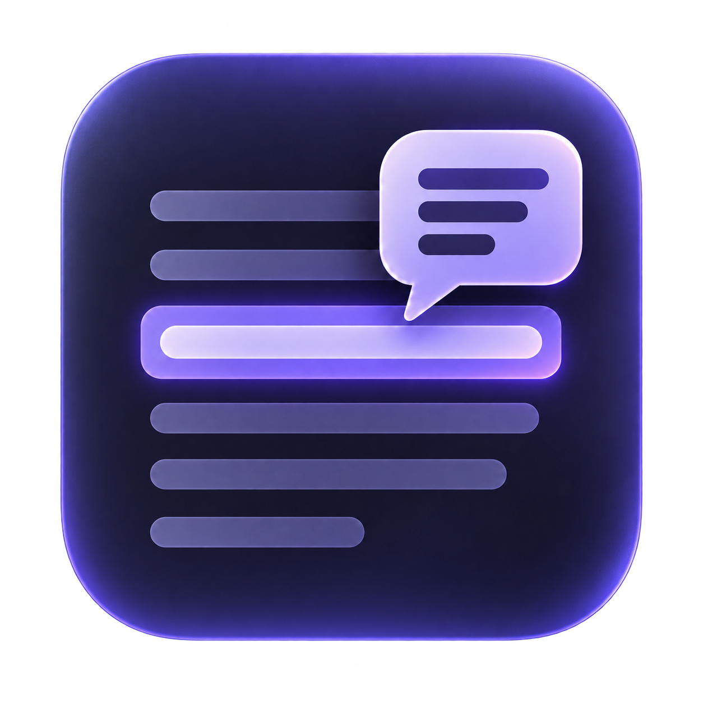

# Annotate

<p align="center">
  
</p>

**Keep context attached to your notes.**

**Annotate** is an obsidian plugin that lets you select a passage, leave a comment, and click its highlight to revisit it or add a reply.

## Features

- 💬 **Comment on any passage.** Start a thread and reply right from its highlight. Full markdown supported, which includes note links, embeds, code blocks, and LaTeX.
- 🤖 **Ask an assistant.** Mention ChatGPT (via `@chatgpt`) or Claude (via `@claude`) for streamed replies about your note. Answers use your current note and highlighted passage as context. Optional, desktop only.
  - Comments stay in your vault without changing your notes. Assistant requests share note content with the selected provider. See [assistant setup and privacy](docs/assistants.md).

## Install

Build from source with Node.js 22 or newer:

```sh
git clone https://github.com/junuxyz/Annotate.git
cd Annotate
npm ci
npm run build
```

Copy `main.js`, `manifest.json`, and `styles.css` into
`<vault>/.obsidian/plugins/annotate/`, then enable **Annotate** in
**Settings → Community plugins**.

Upgrading from Selection Comments? See [migration instructions](docs/usage.md#migrating-from-selection-comments).

## Quick start

1. Select text and press **Cmd+Shift+M** on macOS or **Ctrl+Shift+M** on Windows/Linux.
2. Write a comment and press **Enter** to send. Use **Shift+Enter** for a new line.
3. Click the highlight to reply, or resolve the thread when you're done.

## Documentation

- [Usage](docs/usage.md): editing, resolving, Markdown, and math.
- [Assistant replies](docs/assistants.md): ChatGPT and Claude setup, privacy, and recovery.
- [Storage and limits](docs/storage-and-limits.md): backups, missing text, and supported content.
- [Development](docs/development.md): local updates, validation, and releases.

## License

[MIT](LICENSE) · [Third-party notices](THIRD_PARTY_NOTICES.md)